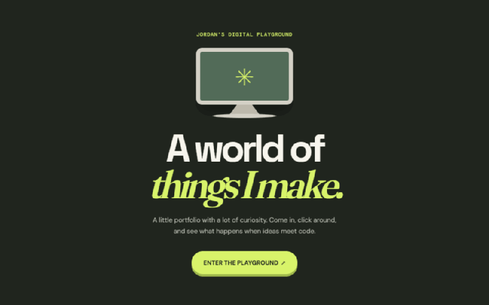
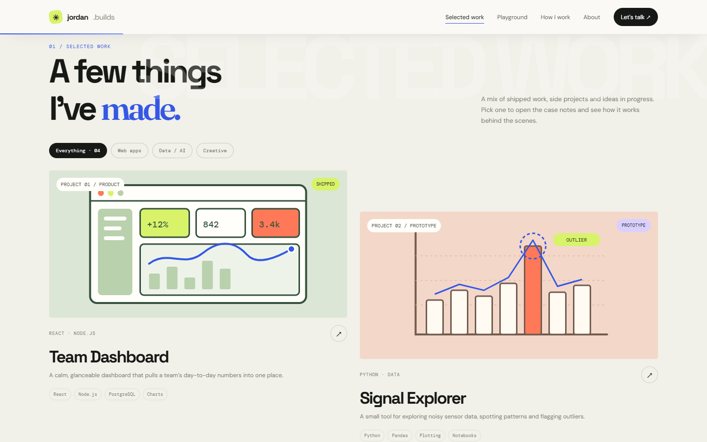
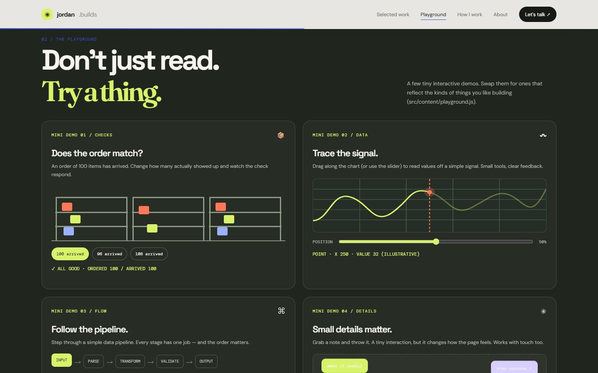

<div align="center">

# ✳ Springy Portfolio

**A modern portfolio template that brings creativity, personality, and interactivity together.**

[Live demo](https://amndazhar.github.io/portfolio-template/) · [Use this template](https://github.com/amndazhar/portfolio-template/generate) · [Customisation guide](docs/CUSTOMIZING.md)



<br /><br />




</div>

## Overview

Springy Portfolio is a portfolio site that feels **physical** rather than static:
- motion runs on real springs
- sticky notes can be picked up and thrown
- case studies grow out of the card you click
- the page responds to how you scroll

It's built to be **made yours quickly**. Every word, project and illustration lives in one folder (`src/content/`), so you can personalise the whole site without touching a component. It stays fast, accessible and responsive, with reduced-motion support throughout.

## Tech stack

- **React 18** + **Vite 5**
- **Plain CSS** with design tokens (no UI framework)
- A **~100-line spring engine**, Web Animations API and Pointer Events (no animation library)
- **GitHub Actions** workflow for one-click GitHub Pages deploys

## Getting started

Requires **Node.js 18+**.

```bash
git clone https://github.com/amndazhar/portfolio-template.git my-portfolio
cd my-portfolio
npm install
npm run dev
```

Open **http://localhost:5173**, then edit **`src/content/site.js`** and watch the page update. For projects, demos, theming and deployment, see the [customisation guide](docs/CUSTOMIZING.md).

## Make it yours ✳

Grab the template, swap in your story, and give it your own spin. If you ship something with it, I'd love to see it: open an issue or drop a link. A ⭐ helps other people find it too.

<sub>Created by [amndazhar](https://github.com/amndazhar) · [MIT License](LICENSE)</sub>
